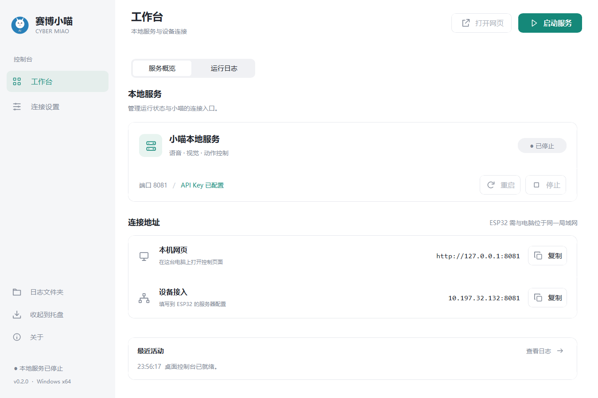

<div align="center">
  
  <h1>赛博小喵 Cyber Miao</h1>
  <p>一只由 ESP32、语音、视觉和舵机动作组成的 AI 桌面猫。</p>
  <p>
    <a href="https://github.com/zhangfuwang66-droid/catapp/releases"></a>
    <a href="https://github.com/zhangfuwang66-droid/catapp/actions/workflows/release.yml"></a>
    
  </p>
</div>

赛博小喵把 ESP32 硬件、Python FastAPI 服务和 Windows 桌面控制台组合在一起。桌面程序负责保存配置、启动服务和查看运行状态；ESP32 通过 Wi-Fi 连接服务，完成语音、摄像头、表情和动作交互。

`v0.2.0` 提供重新设计的 Windows 桌面控制台，适合本机和可信局域网使用。`main` 分支继续开发账号登录、设备配对、独立记忆和云端运行能力；这些源码更新尚未打包进该发行版，新固件的实物联调也尚未完成。

<p align="center">
  
</p>

## 下载

前往 [GitHub Releases](https://github.com/zhangfuwang66-droid/catapp/releases/latest) 下载 Windows x64 版本：

- [CyberMiao-Setup-x64.exe](https://github.com/zhangfuwang66-droid/catapp/releases/latest/download/CyberMiao-Setup-x64.exe)：安装版，提供开始菜单入口、可选桌面快捷方式和卸载程序。
- [CyberMiao-Portable-x64.exe](https://github.com/zhangfuwang66-droid/catapp/releases/latest/download/CyberMiao-Portable-x64.exe)：便携版，下载后直接运行，无需安装。

GitHub 还会自动生成源码 ZIP 和 tar.gz。源码包包含 PCB、3D 外壳和固件目录；两个 exe 只包含运行软件所需的程序文件，不包含这些开发资料。

## 主要功能

- 流式语音对话和语音处理
- ESP32 摄像头画面与视觉问答
- 表情动画、舵机动作和手势追随
- Windows 图形界面配置 DashScope API Key
- 一键启动、停止和重启本地 FastAPI 服务
- 系统托盘、运行日志和服务状态显示
- 聊天记录持久化、连续空闲总结、连接结束总结和重启后的记忆恢复
- Wi-Fi 配网后连接到电脑上的服务

`main` 分支另外提供账号与设备管理页面、设备凭证认证、按主人和设备隔离的聊天记忆，以及个人资料库。上传 PDF、Word 或笔记后，小喵会按当前账号检索相关片段，用于文字和实时语音回答；同账号设备共享资料，不同账号分别管理。见 [资料库使用说明](docs/资料库使用说明.md)、[服务器说明](server/README.md) 与 [USB 配置说明](firmware/tools/README.md)。这些更新尚未包含在上述 exe 中。

## 快速开始

### 1. 启动桌面程序

运行安装版或便携版。程序已经包含 Python 和所需运行库，不需要另外安装 Python。

### 2. 保存 API Key

打开“连接设置”，填入自己的 DashScope API Key 并保存。Key 可在[阿里云百炼控制台](https://bailian.console.aliyun.com/)获取。

### 3. 启动服务

切换到“工作台”，点击“启动服务”。默认端口为 `8081`，服务就绪后可以访问：

```text
http://127.0.0.1:8081
```

健康检查地址为：

```text
http://127.0.0.1:8081/api/health
```

正常时返回 `OK`。

### 4. 连接 ESP32

让电脑和 ESP32 连接同一个局域网，把桌面程序显示的电脑局域网 IP 和端口填入 ESP32 配置。设备不能使用 `127.0.0.1`，必须使用电脑在局域网中的实际地址。

## 工作方式

```text
ESP32 小猫
    │ Wi-Fi
    ▼
Windows 电脑上的 Cyber Miao
    ├── 本地 FastAPI 服务 :8081
    └── DashScope 云端 API
```

本地模式下，电脑负责运行服务和访问云端，ESP32 负责硬件采集与动作执行。账号模式可将后端独立部署在 Linux 服务器上，设备接入前需配置 HTTPS/WSS 和设备凭证，详见 [云端部署说明](server/deploy/README.md)。

## 配置和数据

程序运行数据默认保存在：

```text
%LOCALAPPDATA%\CyberMiao
```

- `settings.ini`：API Key、服务端口和自动打开网页设置。
- `logs/CyberMiao.log`：运行日志，包含 API Key 的脱敏输出。
- `records/`：录制和分析产生的图片等数据。
- `memory.sqlite3`：聊天记录、摘要和长期记忆；`main` 的账号模式还包含身份、绑定及上传的资料原文与索引，请勿公开分享。
- `models/`：用户侧模型缓存；发行版已经内置手部识别模型。

卸载安装版不会自动删除这个用户数据目录，以保留配置和录制数据。API Key 当前以普通配置文本保存，请不要把 `settings.ini` 分享给其他人。

## 从源码运行

需要 Windows 和 Python 3.10 或更高版本。项目在 Python 3.13.14 上完成构建验证。

```powershell
python desktop/setup.py
python desktop/src/launcher.py
```

运行测试：

```powershell
python -m unittest discover -s desktop/tests -v
$env:PYTHONPATH = 'server'
python -m unittest discover -s server/tests -v
```

如果只需要运行独立服务器，可在 `server/.env` 中配置 `DASHSCOPE_API_KEY`，然后运行 `server/start-server.ps1`。

## 构建发行版

正式构建需要 Windows x64、Inno Setup 6，以及当前 Python 环境中的项目依赖：

```powershell
python desktop/build.py
```

版本默认读取 `desktop/VERSION`。构建过程检查依赖、准备固定版本的 MediaPipe 模型、运行 PyInstaller，并验证生成的 exe 的界面资源、配置保存、GUI 启停、本地 HTTP、WebSocket 和服务重启。通过后生成：

```text
artifacts/release/CyberMiao-Portable-x64.exe
artifacts/release/CyberMiao-Setup-x64.exe
```

调试构建：

```powershell
python desktop/build.py --debug
```

更新 `desktop/VERSION` 并提交同版本的中文公告后，推送 `v` 开头的标签会触发 GitHub Actions 的 Windows x64 发布流程：

```powershell
git tag v0.2.0
git push origin v0.2.0
```

GitHub Release 只上传安装版和便携版，源码 ZIP 和 tar.gz 由 GitHub 自动生成。

## 项目结构

```text
catapp/
├── desktop/       Windows 桌面控制台、图标、测试和构建脚本
├── server/        FastAPI 服务、网页和运行依赖说明
├── firmware/      ESP32 固件和烧录工具
├── hardware/
│   ├── pcb/       PCB 文件、物料和生产资料
│   └── enclosure/ 3D 外壳文件
├── docs/          使用、硬件和发布文档
└── artifacts/     本地构建产物，已加入 Git 忽略
```

## 文档

- [文档导航](docs/README.md)
- [软件使用手册](docs/使用手册.md)
- [个人资料库使用说明](docs/资料库使用说明.md)
- [硬件使用说明](docs/硬件使用说明.md)
- [固件构建与升级](firmware/README.md)
- [设备身份与 USB 配置](firmware/tools/README.md)
- [Python 服务器与聊天记忆](server/README.md)
- [云端部署说明](server/deploy/README.md)
- [桌面端开发与构建](desktop/README.md)
- [打包检查清单](docs/打包检查清单.md)
- [中文版本发布流程](docs/发布流程.md)

## 当前边界

- 当前发行版仅提供 Windows x64。
- CI 只验证本地运行、服务启停和网页接口，不使用真实 DashScope Key，也不连接真实 ESP32 硬件。
- 本地模式默认监听 `0.0.0.0`，请只在可信局域网使用，不要直接映射到公网；云端测试入口强制账号模式并仅监听回环地址。
- `main` 的账号与设备隔离已有自动化测试，真实设备的 USB 配置、TLS、音视频并发及多人容量仍待实测，不能据此承诺生产可用或并发数量。
