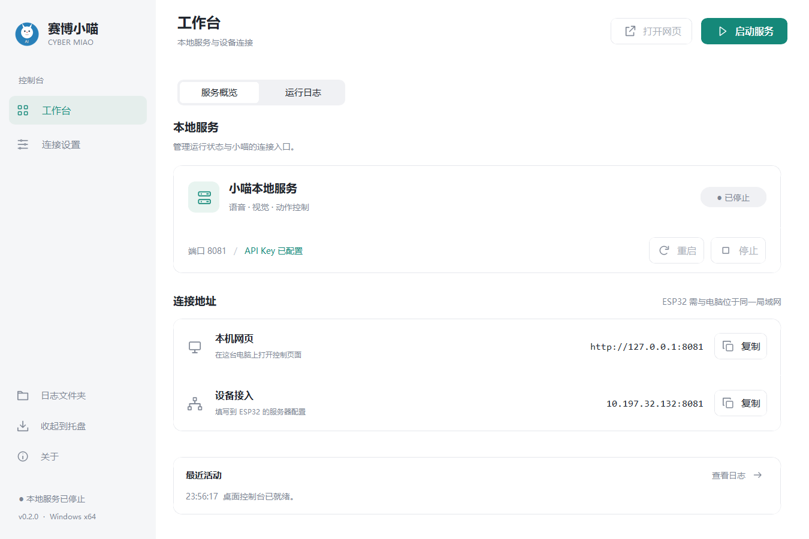

## 全新桌面控制台

这次更新重做了 Windows 桌面界面：浅色侧栏、细边框卡片和更清晰的操作层级，让配置和管理小喵更顺手。

### 更新内容

- 工作台集中显示服务状态、端口和连接地址，支持一键复制。
- “服务概览 / 运行日志”分段切换，日志支持时间标记、异常着色和自动滚动。
- 连接设置重新排版，支持 API Key 显示与隐藏、端口设置和自动打开网页。
- 首次启动进入连接设置，缺少 Key 或配置有误时在页面内提示。
- 统一图标、按钮、间距和状态徽章，适配 Windows DPI 缩放与小窗口滚动。
- 保留服务启停、重启、系统托盘和已有用户配置。

### 下载选择

- **CyberMiao-Setup-x64.exe**：推荐使用的 Windows x64 安装包，提供开始菜单入口、可选桌面快捷方式和卸载程序。
- **CyberMiao-Portable-x64.exe**：免安装，下载后直接运行。
- **Source code**：GitHub 自动生成的源码 ZIP / tar.gz，供开发和硬件制作使用。

两个 exe 均已包含 Python 和运行依赖，不需要单独安装 Python；不包含 PCB、3D 外壳及固件开发资料。

### 升级说明

安装新版或替换便携版即可。已有配置和录制数据保留在 `%LOCALAPPDATA%\CyberMiao`；升级前请退出正在运行的旧版。

### 验证范围

发布流程运行配置、界面与服务集成测试，并对生成的 exe 检查主题、字体、图标、页面切换、配置保存、GUI 启停、HTTP、WebSocket、MediaPipe 本地推理和服务重启。

安装版还会在独立目录中检查安装文件、主程序哈希、安装后运行与卸载，避免夹带开发资料。

本版本未验证真实 DashScope 调用或 ESP32 硬件联调。当前仍用于本地单实例与可信局域网，不提供公网多用户和设备隔离。
